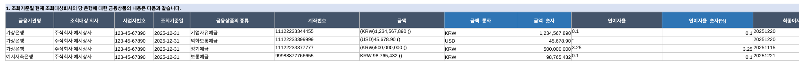

# auditconf — 금융기관조회서 회신 PDF 자동 키인 엔진

 

외부감사에서 받는 **금융결제원 전자조회 회신 PDF**(은행·증권·보험·보증보험)를 읽어
감사 조서용 엑셀로 펼치는 Python 엔진입니다. 회계감사 실무에서 반복되던 "조회서 키인" 작업을 자동화하려고 만들었습니다.


*가상 회사·가상 은행으로 만든 데모 결과. 금액 원문 옆에 실제 숫자 셀(`금액_숫자`)이 붙습니다.*

## 무엇을 하나
- **양식 자동 판별**: 은행·증권·보험·보증보험 4종, 섹션 10개 안팎과 하위 표(2-1, 6-2, 7-3 …)
- **표 복원**: 텍스트 레이어의 단어 좌표로 열을 찾고, 여러 줄로 나뉜 셀과 2행 레코드(증권 거래내역)를 다시 묶습니다
- **숫자화**: `(KRW)61,318,497 ()`, `KRW 154984695.00()`, `WON -206900`, 통화 없는 `122,916,000` 같은 제각각 표기를 통화 + `Decimal`로 변환합니다. 날짜 자리표시자(`00000000`, `00010101`)는 비우고 메모를 남깁니다
- **회신 점검**: 쪽 누락, 확인자 공란, '발급기관에 문의바람' 미기재, 기준일·사업자번호 불일치, 거래내역 기간 이상, 합계행 대사, 거래 상대계좌 교차대사
- **추적성**: 모든 행에 원본 파일명과 쪽 번호

## 어떻게 동작하나
```
PDF ─▶ text_layer   단어·좌표 추출 (회전 쪽 보정, 워터마크 제거)
    ─▶ layout       줄 묶기, 머리말·꼬리말·쪽번호·발급정보 분리
    ─▶ parser       ① 머리글 줄에서 열 키워드 위치 탐색(긴 키워드 우선, 글자 단위 소비)
                    ② 열 중심 사이 중점으로 열 구간 결정
                    ③ 칸이 많은 줄 = 기준 줄, 위·아래로 넘친 조각은 가장 가까운 기준 줄에 결합
                    ④ 금액 뒤 "()" 조각은 왼쪽 금액 열로, 두 열에 걸친 칸은 낱말 단위로 재분할
    ─▶ normalize    금액·날짜·이자율·'없음' 표기 판독
    ─▶ checks       회신 점검·합계·교차대사
    ─▶ excel        요약 · 점검 · 양식별 시트
```

## 검증
- 실제 회신본 12부(회사 2곳, 기관 11곳)로 시험해, 기존 상용 도구 산출물의 금액 109건과 전부 일치했습니다. 고객 자료라 저장소에는 넣지 않았습니다.
- 저장소의 시험은 모두 코드로 만든 **가상 회신본**을 씁니다.

## 실행
```bash
pip install -r requirements.txt
python examples/make_demo.py          # demo/ 에 가상 회신본 2부와 결과 엑셀 생성
python -m engine.cli <PDF폴더> -o 결과.xlsx
python -m pytest -q tests
```
자세한 사용법: [USAGE.md](USAGE.md)

## 이 엔진이 들어갈 전체 시스템
팀 내부용 웹 서비스로 확장하고 있습니다(별도 비공개 저장소).
React SPA → Spring Boot(Kotlin) API → 이 엔진(격리된 parser 컨테이너) → PostgreSQL.
다음 기능: 스캔본·채권채무조회서 OCR, 회신 회수 현황판, 감사보고서 주석 footing·tie-out.
